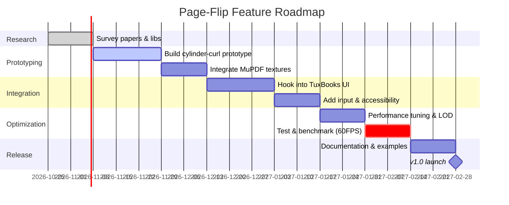

# Executive Summary

Implementing a realistic 3D page-turn effect for TuxBooks (a React/Electron app using MuPDF.js) requires balancing visual fidelity, performance, and integration complexity. Existing libraries (e.g. **StPageFlip** and **OpenPageFlip**) demonstrate two common approaches: canvas-based and DOM/CSS-based flips. Canvas/WebGL solutions (Three.js or WebGL shaders) harness the GPU for smooth rendering, while CSS/DOM approaches leverage hardware-accelerated 3D transforms for simpler shapes. Mesh- or parametric-curl algorithms (cones, cylinders) can realistically deform pages; physics/spring-mesh models are possible but often overkill. We recommend a hybrid design: use WebGL (via Three.js or custom shaders) to render page meshes for maximum control and performance, with MuPDF providing bitmap textures at each page. Pages are rendered on-demand into textures (possibly mipmapped for quality) and mapped onto triangular meshes shaped by a cylindrical page-curl algorithm (with adjustable apex and angle parameters, per PARC research). This yields a realistic curl without the complexity of a full physics sim.

Key priorities include limiting texture memory (e.g. releasing off-screen pages), running the flip animation at ~60 FPS (minimum 30 FPS) with low CPU load, and supporting smooth user input (drag/touch with inertial “flip momentum”). Integration with TuxBooks features (text selection, annotations, search) can be achieved by overlaying highlight layers or by synchronizing MuPDF’s DOM/text layer with the 3D view once the page turn completes. Development should proceed in phases (library evaluation → prototype curl model → integration → polish/testing), with benchmarks (FPS, latency) at each step. In the following, we analyze algorithms, rendering strategies, libraries, performance trade-offs, and propose a design, API sketch, and roadmap.

## Algorithmic Approaches

Several algorithms can produce a “page curl” effect. A **parametric curl** model maps each 2D page point onto a 3D surface (typically a cone or cylinder). In the PARC “cone model” (used by early iPad pages), the page wraps around a cone whose apex position _(A,B)_ and angle θ change over time. Chris Luke’s analysis shows mapping formulas: e.g. radius _R = √(x²+(y–A)²)_, cross-section radius _r=R⋅sinθ_, and angle _β=asin(x/R)/sinθ_, with resulting 3D position

```
v1.x = r⋅sin(β);
v1.y = R + A – r⋅(1–cosβ)⋅sinθ;
v1.z = r⋅(1–cosβ)⋅cosθ;
```

. This gives a smooth curl but requires careful tuning of A, B, θ over time. Luke found that a **cylindrical model** (bending around a cylinder of radius C) can simplify math and allow flat portions of the page before/after the cylinder. In practice, one can pick one model (cone or cylinder) and derive the inverse mapping from a drag point to cylinder parameters, solving equations such as Δ, h, c distances. These parametric models yield convincing curling without a full physics sim; we recommend a cylindrical-page approach (as it handles dragging more directly) and empirically adjusting parameters over the animation.

By contrast, a **mesh-based (vertex) approach** discretizes the page into a grid and explicitly computes vertex deformations. One can either precompute a sequence of meshes (as a frame-by-frame animation) or compute vertex positions on-the-fly via shaders or CPU (e.g. free-form deformation, Bezier-controlled warp, or even a simple spring-mass lattice). For example, bone or blend-shape animations in 3D tools have been used in game engines, but these are static animations rather than interactive. A fully **physics-based** simulation (treating the page as a mass-spring sheet or FEM surface) could yield the most realistic bending and secondary motions, but the computational cost is high (and overkill for a UI transition). Therefore, we suggest a controlled parametric/cylinder model plus a modest mesh grid (e.g. 32×32 vertices) so that vertex deformations are done in a vertex shader for GPU speed. In summary, **parametric (cone/cylinder)** or **vertex-shader** deformations offer a good trade-off: realistic curl and interactivity with only linear algebra in the shader (no iterative physics).

**Bezier/FFD** techniques (e.g. treating page edges as Bezier curves that interpolate the folding) have been explored in some 2D book flips, but they lack inherent 3D realism (they deform 2D shapes). They might be used to create a simpler CSS-based illusion (bending edges), but for true 3D we focus on parametric/mesh models.

## Rendering Strategies (Three.js/WebGL vs. Canvas2D vs. CSS/DOM)

We compare three rendering routes:

- **WebGL/Three.js (GPU)**: Create a 3D scene with a paper mesh for each page. Use textured materials (front/back textures) and actual 3D transforms. GPU acceleration yields high frame rates and quality (antialiasing, shaders). Lighting (diffuse+specular) and shadows can be implemented easily in Three.js or raw WebGL. WebGL allows large meshes (high tesselation for smooth curls) and high-resolution textures with mipmaps. It needs careful resource cleanup (gl.deleteTexture) as memory is precious. Integration with React can use react-three-fiber or manual canvas insertion.
- **Canvas2D**: Render each page via 2D canvas (MuPDF can draw into a `<canvas>`). StPageFlip uses 2D canvas by drawing many vertical stripes or by pre-generated images. Canvas operations are CPU-bound (drawImage, fills), so high-res pages or many vertices can slow down. Canvas is easier to integrate (no 3D context setup) but less smooth for complex curls. Weighing the rendering of curved strips vs. images, Canvas might hit >16 ms per frame on large pages. Given modern hardware and the need for mobile support, canvas-only may struggle at 60 FPS.
- **CSS/DOM (HTML)**: Use `<div>` elements with CSS 3D transforms to fake page flips. Turn.js does this by slicing pages into elements and rotating them with `transform: rotateY` and skew to simulate curl. Pros: very simple to integrate, hardware-accelerated, low CPU. Cons: limited fidelity – it can only perform planar transforms (no per-vertex bending). Achieves a “hard page” flip, or fake softness with gradients, but cannot do realistic bending or shadows beyond CSS shadows. Also, stacking many DIVs for the curvature can become complex. This approach is fast for simple covers but not as flexible for advanced realism.

**Performance Trade-offs:** WebGL wins for complex scenes: GPUs can process thousands of vertices and textures in parallel. Canvas2D hits CPU limits on heavy redraw. CSS transforms are lean on CPU (delegated to GPU) but limited to rectangle/fixed shapes. Since TuxBooks already uses Web technologies, Three.js (or raw WebGL) is recommended for best performance. For example, one can create a `THREE.PlaneGeometry` mesh and update vertex positions in the vertex shader each frame according to our curl formula, while the GPU handles interpolation and rasterization.

## Texture Management

Pages (PDFs or images) must be converted to textures. With MuPDF.js/WASM, each page can be rendered to a hidden `<canvas>` at a chosen DPI. We should generate textures at an appropriate **resolution**: e.g. 2×–3× the display DPI to ensure crispness, or use multiple resolution mipmaps. For large PDFs, render on demand: only current, previous, next pages are needed for the flip; others can wait. Use MuPDF in a Web Worker to avoid UI jank when rendering large pages. Upload the rendered image to WebGL as a texture (`gl.texImage2D`), and generate mipmaps (`gl.generateMipmap`) for scaling. Textures (front/back images) should be cached with LRU logic: after a page is off-screen for some time, free its texture to stay within memory limits (Electron has ~1–2 GB depending on platform). We should test memory with, e.g., 8 MP pages × 5 loaded at once = ~160 MB (RGBA), so budget accordingly.

Mipmap usage helps with downscaling when the page is small or zoomed out. If pages have transparent elements (handwriting annotations), use RGBA textures; else RGB. If the library supports it, use **compressed textures** (e.g. WebGL compressed formats) to save memory, though on web these are complicated by browser support. As a simpler approach, ensure textures are power-of-two dimensions to enable mipmapping without WebGL2.

For **React/CSS** modes, MuPDF can paint directly into HTML `<canvas>` or generate `` which are then placed as backgrounds of DIVs. StPageFlip, for instance, alternates between using raw HTML and canvas. But for the WebGL route, we focus on textures as above.

## Performance Optimizations

To hit ~60 FPS, the heavy work (vertex warping, texture drawing) must be GPU-accelerated or incremental. Key optimizations:

- **GPU vs. CPU**: Delegate page deformation to shaders (GPU), avoid per-vertex JS loops each frame. Use `requestAnimationFrame` for timing. As MDN notes, WebGL can use hardware acceleration, whereas Canvas2D relies on software rendering.
- **Level of Detail (LOD)**: For pages that are only partially visible (e.g. back faces or distant in 3D), use coarser meshes or lower-res textures. For instance, when a page is nearly flat, we can reduce vertex count or skip the curl algorithm. Or render the backside of the page as a flat quad (no curvature) once past 75% turn.
- **Culling**: Only render the two flipping pages and perhaps static neighbors. Hide or detach canvases/meshes for off-screen pages. Even in WebGL, do not draw pages fully turned.
- **Batching/Instancing**: Multiple pages could potentially share a mesh template and use instanced draws, but since each page has unique texture and curl state, instancing is less straightforward. Instead, ensure draw calls are minimal (one draw per page mesh).
- **Incremental Texture Updates**: MuPDF rendering is expensive. Pre-render the next page while the current flip is happening. Delay heavy resolution until the moment before it’s needed. For example, initially load a low-res version, then update to high-res on idle.
- **Memory Limits**: Electron’s JavaScript heap may be limited (32-bit ~1.5 GB, 64-bit ~ unlimited). However, GPU memory is more precious (often ~512MB on older GPUs). Clean up unused textures and geometries promptly. Profile with Chrome DevTools and consider safe caps (e.g. at most 3 high-res pages in memory).
- **Recycle Buffers**: Reuse canvas buffers or `WebGLFramebuffer` objects when possible.
- **Minimize Overdraw**: In WebGL, enable depth testing so only visible surfaces render. In CSS, minimize layers.

Aim performance targets:

- **Frame Rate**: ≥ 30 FPS on average machines (60 FPS on high-end). If needed, allow a reduced-detail mode (half FPS on mobile).
- **Memory**: Keep app footprint < 500 MB for documents up to ~100 pages (with lazy-loading).
- **GPU Time**: Ideally < 5 ms per frame on the flip animation (vertex + pixel work).

## Input Handling

Flip interaction should feel natural: dragging a corner or edge, with momentum-based page release. Key considerations:

- **Corner Grab vs. Edge**: Common effect: user drags the bottom-right or top-right corner to turn. Track pointer (mouse/touch) and map its 2D screen point to the page’s curl parameters. Clamping ensures the page can only curl up to its bounds.
- **Velocity/Throw**: On release, use the drag velocity to determine if the page continues flipping or snaps back. For example, if drag >50% of width or velocity above a threshold, animate to full turn; otherwise animate back. This is akin to UX in mobile gesture APIs.
- **Touch vs. Mouse**: Handle touchmove events similarly to mouse. Consider pointer events API for unification. Support multi-touch? Probably not needed (only one finger turning one page at a time).
- **Accessibility**: Provide keyboard handlers (left/right arrows to flip). For screen readers, possibly allow a semantic “Next Page” action that triggers the flip. Provide ARIA labels for the book container.
- **Events**: Expose callbacks (e.g. onFlipStart, onFlipEnd) so TuxBooks can pause text selection or annotation during a flip.

Standard libraries handle basic dragging but integration with a custom warp means we must map (x,y) to (A,B,θ). We should invert the cylinder equations (like in [21] where Δ is solved) to set the cylinder angle from the pointer position. Alternatively, treat the drag as controlling a small portion of the curl at the corner edge and gradually increase the global curl to that.

## Visual Realism

Realism comes from details:

- **Paper Thickness**: Give pages a small thickness. In Three.js, model pages as two-sided planes with a slight offset, or extruded meshes with a thin edge. Use a constant-edge color (paper edge color) on the “thickness” geometry.
- **Back Textures**: Render a page’s backside (if visible) with its own texture (often blank or gray) or a mirrored content (if double-sided). For books, the back of a page might show bleed-through or a book cover back. Support two textures per page: front and back.
- **Shadows**: Soft shadows under the bending edge give depth. In WebGL, add a directional light and enable shadows on the mesh. Alternatively, overlay a semi-transparent dark gradient under the curl. Some libraries fake shadows with DOM gradients.
- **Lighting/Specular**: If pages are glossy (e.g. magazine), a slight specular highlight can add realism. Material with tuned `roughness` or Phong reflection helps. Even a simple ambient+diffuse light model suffices; the MDN note on hardware acceleration implies these effects cost little in WebGL.
- **Anti-Aliasing**: For crisp visuals, use MSAA or FXAA shaders. Three.js can enable antialiasing on creation. Text edges should be sharp; consider rendering MuPDF text with subpixel antialiasing at high DPI. Gamma-correct blending prevents darkening of textures.

Overall, we want the page to look like real paper curling in 3D, not just a flat plane rotating. Using shaders to curve a mesh with normal vectors responds to lighting, reinforcing realism.

## Integration with TuxBooks Features

TuxBooks likely supports text selection, annotations (overlays), and search on PDF pages. During a page flip:

- **Text Selection**: If a user has selected text, we should probably cancel or freeze selection when a flip starts. Alternatively, split the selection and animate highlights. In practice, simpler: disable text-layer interaction during flip.
- **Annotations**: If annotations (e.g. highlights, notes) exist, render them onto the page texture before the flip. MuPDF can render annotations with the page. Thus the texture used for the flip includes all annotations (so they move with the page). If annotations are HTML overlays, one could snapshot them onto the canvas.
- **Search/Find**: Search results typically scroll to a page; a flip should animate there. E.g. on “find next”, flip to the page containing the result. Implement as: if target page ≠ current, programmatically initiate a flip animation to that page.
- **Pagination**: Keep internal page indices in sync. Many libraries provide methods `.flipNext()` etc. TuxBooks’ pagination control should tie into the flip: e.g. when “Next Page” button is clicked, trigger the flip instead of instantly swapping.
- **EPUB Reflow**: Not specified, but if supporting EPUB where pages reflow, the flip effect might need to recalc geometry on resize (width changes). That’s a separate concern. Focus on PDF as fixed-size pages.

In summary, integrate by treating the flipping engine as a view over the PDF: pass current page images from MuPDF, and intercept user actions to drive flips. After the flip animation completes, update React state (current page index).

## Cross-Platform Constraints

TuxBooks runs on Desktop via Electron (Chromium) and may target Web or mobile later. Our solution must work in Chrome/Edge/Safari/WebKit. WebGL is available on desktop and most mobiles; on older devices fallback to Canvas or simple CSS may be needed. Electron allows up to WebGL2 on modern GPUs. Performance budgeting should assume desktop-first: modern GPUs easily handle page meshes, whereas mobile might require lower resolution or simpler effects. If a mobile/web port is needed, one could detect device and reduce detail (e.g. use CSS flip instead of full mesh on low-end).
Because TuxBooks is TypeScript/React, all library code should be TS-friendly (StPageFlip and OpenPageFlip are TypeScript). Three.js has TypeScript definitions. No native modules (except WASM MuPDF) are required, so cross-platform is straightforward.

## Licensing & Maintenance

Use permissively-licensed libraries to avoid legal issues. StPageFlip (MIT) and OpenPageFlip (MIT) are safe. Turn.js (non-commercial BSD) is **not** suitable for open source/commercial products. Any commercial flipbook plugin should be avoided or purchased. Three.js (MIT) is free. Maintainability: choose active projects. StPageFlip has ~900 stars and is maintained. OpenPageFlip is newer but recently updated (“3 weeks ago” on GitHub). React bindings for OpenPageFlip exist. Physics engines (Box2D etc.) are overkill and heavy (usually GPL or LGPL). Avoid such complexity.

Development plan should include updating dependencies regularly and isolating flip code (e.g. in its own module) so future swaps are easy.

## Comparative Table: Candidate Libraries/Approaches

| Library/Approach      | Type                   | Platforms                        | Pros                                                          | Cons                                                          | License        |
| --------------------- | ---------------------- | -------------------------------- | ------------------------------------------------------------- | ------------------------------------------------------------- | -------------- |
| **StPageFlip**        | Canvas2D (JS)          | Web/Electron (Mobile compatible) | Easy HTML/image input; flexible config; supports “hard” pages | CPU-bound on large pages; limited to canvas; fewer 3D effects | MIT (open)     |
| **OpenPageFlip**      | DOM/CSS 3D (JS/React)  | Web (React)                      | True HTML content pages; server-renderable; MIT; active dev   | Limited page bending (CSS flip only); complexity for meshes   | MIT (open)     |
| **React 3D Flipbook** | Three.js/WebGL (React) | Web (React)                      | GPU-accelerated; realistic 3D; can map PDFs to textures       | Larger dependency (Three.js); potentially more dev effort     | MIT (?)        |
| **Turn.js**           | CSS 3D (jQuery)        | Web, but jQuery                  | Simple; many examples; hardware-accel transforms              | Non-commercial license; limited to rectangle flips; outdated  | Non-commercial |
| **Custom Three.js**   | WebGL (JS/TS)          | All modern browsers              | Fully customizable; highest realism (shading, shadows)        | Most development time; need implementing page algorithm       | Developer      |

**Pros/Cons Summary:** Canvas libs (StPageFlip) are easy to use but may struggle at high resolution. CSS libs (Turn.js) are very fast but visually simplistic. WebGL solutions (React-3D-Flipbook or custom) give the best visual fidelity and performance on GPU, at the cost of more code. Given TuxBooks’ needs (complex PDF pages, annotations), a WebGL/Three.js-based approach is likely superior. However, OpenPageFlip is worth evaluating for quick integration if 3D realism is less critical.

## Recommended Algorithm Design

We recommend a **cylindrical-curl mesh** algorithm implemented via WebGL:

1. **Mesh Generation:** Predefine a 2D rectangular mesh for a page (e.g. 40×40 grid). Store vertex positions `(x,y,z)` and texture coords. Initially, z=0.
2. **Parameter Computation:** On each frame, given the drag corner point (or elapsed animation time), compute cylinder parameters A, B, θ (and radius C). For example, B = `windowWidth*(dragX/proportion)`, A = constant offset, θ from dragY. Alternatively solve `Δ = (y^2 - x^2 + ...)/(2x+2c-2)` as in Luke’s derivation.
3. **Vertex Deformation (Vertex Shader):** In the vertex shader, for each mesh vertex at flat coords `(xi, yi)`, apply the cylindrical mapping. Pseudocode (cf. Luke’s cylinder code):
   ```
   // fixed cylinder parameters: A, B, C, theta
   float sx = B + ( (yi - A) / tan(theta) );
   float cx = (C * PI) * sin(theta);
   float tx = clamp(xi - sx, 0, cx);
   float beta = (tx / cx) * PI;
   float dy = tan(PI/2 - theta) * (tx / cx);
   vec2 v0;
   v0.x = C * sin(beta);
   v0.y = C * min(dy, 2.0);
   // rotate v0 by (theta - PI/2) in XY plane
   float sinT = sin(theta - PI/2), cosT = cos(theta - PI/2);
   vec2 v1;
   v1.x = v0.x * cosT - v0.y * sinT;
   v1.y = v0.x * sinT + v0.y * cosT;
   // translate into place
   v1.x += sx;
   v1.y += yi;
   float z = C * (1.0 - cos(beta));
   if(xi < sx) { // flat before cylinder
       v1 = vec2(xi, yi); z = 0.0;
   } else if(xi > sx + cx) { // flat after cylinder
       // additional translation for excess
       float xx = xi - (sx + cx);
       float sinT2 = sin(theta*2), cosT2 = cos(theta*2);
       v1.x += xx * cosT2;
       v1.y += xx * sinT2;
   }
   gl_Position = project(v1.x, v1.y, z);
   ```
   This produces the curling page shape, with a flat region before/after the cylinder. The fragment shader then samples from front or back textures based on the sign of `flipDirection`.
4. **Animation Timing:** Update A, B, θ over time using easing functions (e.g. cubic ease-out), or directly from drag. For a simple flip, θ might go from 90° → 0°, and B from half-page to near opposite edge.
5. **Data Structures:** Store page textures in a `Map<pageIndex,WebGLTexture>`. Store page flip state (current, target, fraction) in a flip controller object. Use classes or React refs for the canvas and flip controller.
6. **Page Turn Logic:** On “next” or drag beyond threshold, increment page index and animate parameters to next page orientation. Keep track of left/right page.

This design tightly integrates with MuPDF: after rendering a page image (via MuPDF canvas), upload as a texture for that page’s front. Optionally generate a backside texture (blank or colored) for realism. Update the page mesh’s `material.map` accordingly.

## Performance Budget Targets

- **Frame Rate:** Target 60 FPS on typical desktops (Nvidia/M1), 30 FPS as minimum on older hardware. Achieve by offloading warping to GPU shader.
- **Input Latency:** <100 ms from gesture to motion (virtually no noticeable lag). Use GPU-friendly pointer events.
- **Memory:** Keep total textures + buffers under ~500 MB for large docs. Example budget: 3 pages × 2048×2048 RGBA = ~50 MB, plus overhead. Unload unused.
- **Pipeline:** Allow 8–16 ms/frame for main loop (including input, physics, draw). Let shaders do heavy lift to minimize CPU use.

These budgets ensure a smooth, app-like feel.

## API/Interface Sketch (TypeScript)

```ts
interface PageFlipSettings {
  width: number; // base page width in CSS px
  height: number; // base page height
  showCover?: boolean; // include first/last cover
  acceleration?: boolean; // use requestAnimationFrame
  onFlipStart?: (prev: number, next: number) => void;
  onFlipEnd?: (newIndex: number) => void;
}
interface PageFlipAPI {
  flipNext(): void;
  flipPrev(): void;
  flipTo(pageIndex: number): void;
  loadPageTexture(pageIndex: number, img: HTMLImageElement): void;
  // e.g. image from MuPDF
  // (Alternatively: loadFromMuPDF(pageIndex: number) => Promise<void>)
}
function createPageFlip(container: HTMLElement, settings: PageFlipSettings): PageFlipAPI;
```

Example usage:

```ts
const flip = createPageFlip(document.getElementById("book"), {
  width: 600,
  height: 800,
  showCover: true,
});
mupdf.renderPage(canvas2D, currentPage).then(() => {
  flip.loadPageTexture(currentPage, canvas2D);
  flip.loadPageTexture(currentPage + 1, nextCanvas);
});
flip.onFlipEnd = (newIndex) => {
  console.log("Now at page", newIndex);
};
```

Under the hood, `createPageFlip` sets up a WebGL (or canvas) renderer, handles user input events on `container`, and exposes these methods. Integrating with MuPDF means calling its render API and passing the resulting image into `loadPageTexture`.

## Roadmap & Milestones



- **Milestones:** Complete prototype (flip working with textures), then integrate selection/annotations, then optimize.
- **Risks:** Texture loading lag (mitigate by preloading next page), mobile slowdown (plan fallback), integration bugs (incremental testing).
- **Mitigation:** Use performance profiling early; test on target devices; simplify visuals if needed (e.g. flat flip if too slow).

By following this plan, TuxBooks will gain a high-quality, performant page-turn effect that dovetails with existing PDF rendering and user features. Each design choice and library is grounded in practical trade-offs, ensuring a maintainable, polished outcome.

**Sources:** Realistic page-curl models; example libraries (StPageFlip); WebGL performance (GPU acceleration); MuPDF.js capabilities.
